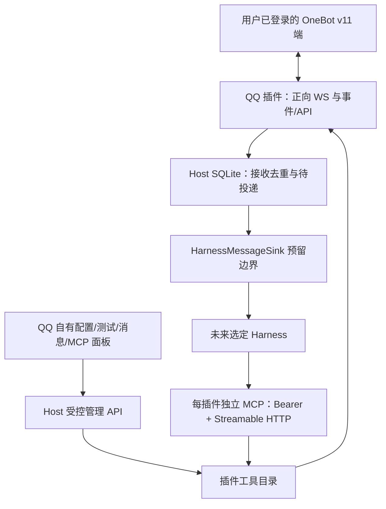

# Eating QQ 与平台能力架构

状态：正式 QQ 插件 0.2 的协议/Host/MCP/浏览器证据保留；当前已按[单仓独立包方案](工程结构与插件发布.md)完成重组，产物加载与安装流程于 2026-10-27 完成回归，见[重组报告](../reports/2026-10-26-单仓独立包重组报告.md)。真实用户 QQ 账号尚未连接。产品不再提供飞书/微信占位模块，测试协议端仅在测试目录。

## 职责与数据流

Host 不生成 AI 回复。QQ 插件接收平台输入、验证/保留来源并交给持久接口；尚无 Harness 接收者时保持 pending。MCP 是让 Harness 主动调用工具的通道，与输入消息推送是两个方向，不因为 MCP 可用就声称 Agent 已感知。

## 插槽与功能目录

[公开后台 SDK](../../packages/plugin-sdk/src/index.ts)定义后台入口、能力/工具、连接状态、消息信封和接收者接口；[公开界面 SDK](../../packages/ui-sdk/src/index.ts)提供面板契约与受控 API 客户端。插件前后端分别注册，[QQ 后台](../../plugins/communication/qq/src/server.ts)、[QQ 面板](../../plugins/communication/qq/src/web/panel.tsx)拥有协议与专属[配置类型](../../plugins/communication/qq/src/config.ts)，通用 SDK 不含 `OneBotConfig`。

QQ 以 `@eating/plugin-qq` `0.2.0` 独立构建，Host 按已安装产物加载后台，Web 动态加载 Host 提供的界面资源并共享公开 SDK/React 宿主实例。面板不引用 Web 应用私有源码，主程序不静态捆 QQ；包与安装边界见[工程结构](工程结构与插件发布.md)。

[工具目录](../../plugins/communication/qq/src/backend/operations.ts)是 MCP tools/list 和测试面板参数的共同来源。扩展新功能时在插件内声明 schema、语义和实现；Host 不新增 QQ 条件分支。当前10项：账号、状态、版本、好友、群、单消息、Eating已收消息、私聊发送、群发送、撤回。

本版发送为纯文本，显式 `auto_escape=true`，不把任意 CQ 码当普通文本执行。图片/复杂消息段的发送、群管理、QQ空间发布/评论需后续真实能力扩展；不用任意 action 透传绕过目录与权限。

## 连接与事件

OneBot v11 正向统一端点承载 API 和事件。Bearer 只在请求头，不放 URL；拒绝 URL 账号密码、查询令牌、独立 `/api`/`/event` 和重定向。实际 `get_login_info` 加 `get_status` 在线/健康核验后才显示 connected。

每次请求 UUID echo，乱序可关联；限载荷/未决数量、超时、有限退避和存活检查。手动断开不自动复活。副作用超时/断链/异步ACK保留unknown，不自动重发。后台异常和事件保存失败可见，不吞掉后假装成功。

收到私聊/群消息先持久化；稳定去重键包括本地实例、实际QQ号、会话目标与原message_id。外部sender始终外部来源，正文不能冒充主人。群转交开关只控制是否加入Harness待投递，不表示协议端不再收到群消息。

## 账号与存储

本版仅一个默认实例；插件身份 `qq`、稳定本地实例 UUID、实际登录QQ号分别记录。目录、索引和后续多账号边界见[数据规范](../technical/数据目录与账号实例.md)。

消息查询按实例隔离；发送幂等范围为插件+实例+实际QQ号+request_id。相同键同参数重用已知结果；不同参数拒绝；未知结果不重做。进程中断后running转unknown，不假装平台未发送。

## Host 与 MCP

管理API使用本地会话/CSRF，Host/Origin与请求体检查；MCP独立插件Bearer，只绑定回环。官方SDK提供真实初始化、工具列表与调用。每POST为stateless通道，不虚构会话；停用撤销通道和新调用，已发出的平台动作不能靠HTTP断开撤销。

工具日常使用遵循已批准能力，不默认每次主人审批；功能测试面板的真实发送/撤回额外要求手动确认。MCP并未注册到任何真实Harness，界面明确显示这一事实。身份权限/OS隔离仍有后续工程边界，不将TypeScript命名空间称为恶意插件沙箱。

## Harness 消息预留

`HarnessMessageSink.deliver(event, signal)` 接受结构化协议版本、稳定eventId、pluginId/instanceId/accountId、conversationId、sender、接收时间和外部来源。唯一主接收者可注册，未知结果转uncertain不盲投；明确未接受可有限重试；accepted只是接收确认。

未来适配器须提供恢复核对和真正模型准入证据，接口仍可按需求修改。当前没有AI推理或第二套意图引擎。

## 验证与限制

重组前正式 QQ 阶段 215 项单元/集成及 5 浏览器场景已通过，含真实官方 MCP 客户端与回环 OneBot 夹具、SQLite 重开与中断恢复；本轮独立包另行完成完整构建/严格 TS、Vitest 280/280、Playwright 8/8、四包独立 pack 和仓库外安装/MCP/升级/删除构建源后重启/卸载数据保持，见[重组报告](../reports/2026-10-26-单仓独立包重组报告.md)。没有向真人发送，没有验证真实协议实现或账号、WSS证书部署、反向WS、多账号并行、QQ空间、远端暴露或桌面打包。

使用方法见[配置与功能测试](../operations/QQ配置与功能测试.md)，官方依据见[协议核对](../research/QQ协议与MCP核对.md)。
