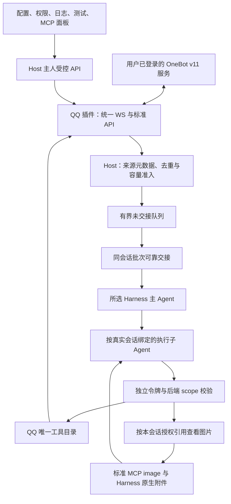

# Eating QQ 与平台能力架构

更新：2026-10-29。QQ0.10.0通过公开SDK3.0.0与唯一API3接入Host，提供正式OneBot v11连接、原39项标准工具及1项受控查看图片扩展，共40项。默认不兼容旧Eating版本，见[ADR-0015](../decisions/ADR-0015-默认不兼容旧版.md)；时间与图片能力见[ADR-0016](../decisions/ADR-0016-原生只读Web与多模态会话.md)，官方Web原样接入见[ADR-0017](../decisions/ADR-0017-原样接入DSH原生Web.md)，实际流程见[操作说明](../operations/QQ配置与功能测试.md)。

## 职责和数据流

Host不生成AI回复，普通模型文本不转发QQ。QQ核对实际账号与发送者，再把规范化外部信封交Host；Harness自主决定是否委派或沉默。无接收者时仅保有界待投递，不称Agent已读。

## 插件和工具

QQ[后台](../../plugins/communication/qq/src/server.ts)和[面板](../../plugins/communication/qq/src/web/panel.tsx)只依赖公开SDK，不引用应用内部。入口／实际插件／清单种类都为communication，缺失或API不符拒绝，不默认推断。独立产物安装方式见[工程结构](工程结构与插件发布.md)。

[唯一目录](../../plugins/communication/qq/src/backend/operations.ts)同时供Host、MCP与功能测试使用。原38公开标准API加1框架quick，共39项，仍保持19只读／20副作用／3敏感结果及OneBot JSON语义；API3的resultFormat显式为json。新增qq_view_received_image为受控只读扩展，resultFormat为content，返回标准MCP image内容，总目录40项。它与标准get_image查询职责分开，不改变原39项参数或回执。标准参数、正式别名及19种可发送段见[覆盖清单](../technical/OneBot标准功能覆盖.md)。没有任意action透传，也没有本地聊天历史工具。

文本、数组和单段对象按正式schema校验。字符串默认auto_escape=true，显式false才解释CQ；forward接收后可读取，不冒充发送支持。标准OneBot媒体发送与查询继续按协议处理file／URL／Base64，不本机读文件；查看收到的图片按下节独立受控获取真实字节。

## 当前配置、连接与身份

当前完整QQ配置wrapper只收schema2，缺权限或连接字段拒绝，不从旧配置补齐。真正新实例通过工厂生成完整默认。账号索引维持当前schema1，稳定instanceId与真实accountId分开；目前仅运行一个默认实例，不宣称多账号并行。

统一正向WebSocket同时承载API与事件，Bearer只在头，不接受URL凭据／查询令牌或分离api/event端点。登录资料、online/good成功才显示connected。请求以echo关联，超时／断链／async接纳的副作用为unknown，不自动重发。

主人／管理员配置为安全正整数十进制QQ列表，各最多100；重叠owner优先。接收事件self_id必须匹配实际登录号，sender只按已保存名单核对；正文、昵称或OneBot群角色不授予Eating主人权限，source仍external。结构化媒体／转发引用可作为scope来源，不从普通文本或任意URL授予引用。

连接配置PATCH省字段保当前、空token保原是当前语义；权限通过完整字段＋policyRevision CAS单独保存，不重连。配置读取失败明确错误，不渲染会补默认值的可写空表单，原文件不覆盖。

## 代理类型与执行

QQ声明qq.private／qq.group及各自规则、主委派说明和可选／默认工具。子目录从当前40工具派生，只包含能绑定当前会话的能力；默认适用只读加本类型明确发送，图片查看仍受实际勾选与引用约束。凭据、无关全局维护、通用send_msg和quick不进入当前子目录，主人手动标准39项不删除。

工具目录、类型勾选和实际invokeScoped共同检查权限，不能只靠提示词或隐藏名称。每次核对插件／实例／登录账号／类型／目标；消息查询／撤回只用已授权messageId，媒体／转发只用已知resourceId，递归回复／node引用同样检查。发送成功的真实message_id可继续授权本会话查询。

原生执行实例的创建标签与Eating离线summary使用“平台-绑定登录账号-私聊／群聊-对方／群号”，使用注册pluginName和scope.accountId，不把账号实例UUID显示成登录号。切号产生独立绑定，历史实例的账号和原生UUID不改；qq.private／qq.group仍是类型ID。原生Web按官方机制显示名称，不注入agentLabels前端映射，也不承诺全部历史旧标题外观修正；平台信封JSON与工具结果按官方默认组件原样呈现，不注入Eating消息renderer。Eating自有面板仍可展示离线summary与核验source，见[Harness设计](Harness适配.md)。

子凭据按任务发行，结束、停用、断开撤销。写请求用agentId＋原request_id命名空间，避免不同代理键冲突；Host真实回执按任务隔离，迟到旧调用不污染新集合。主收到子摘要和实际动作回执后再判断下一步，普通final不自动发送。

## 受控查看收到的图片

qq_view_received_image只接受当前授权账号／会话的消息及图片资源引用，message与resource须有已核验的配对关系；分别出现在不同引用集合不足以授权交叉读取。子代理不能提交任意本机路径或任意网址，获取后返回前再次检查当前权限和引用，撤权或切号后不能由迟到结果恢复访问。

可用公网图片URL通过公共DNS校验并固定所选地址，禁止私网／本地目标与重定向，不把OneBot或Host鉴权头传给图片站点。读取上限5MiB、超时10秒，同时核对MIME与真实字节格式；超限、类型不符或获取失败明确报错。OneBot仅给远端路径且无可用获取接口时返回MEDIA_UNAVAILABLE，不读Eating本机文件、不登录远端服务器，也不猜下载地址。

本轮真实失败的CDN主机multimedia.nt.qq.com.cn经dns.lookup仅返回198.18.7.115，符合Fake-IP特征；当前SSRF对198.18/15保留段的拒绝发生在HTTP GET前。imageInput当前为true，不能归为能力关闭。未确认具体代理来源，不记录QQ标识、签名URL、rkey或消息正文。本轮不改图片策略，仅说明用户网络DNS层恢复真实公网解析，或未来明确授权受信图片代理；不全局放行198.18／私网，不开放目录，不声称此次真实公网图片已通。

工具返回真实标准MCP image块，DSH原生MCP客户端保存为原生附件并交给明确支持image输入的执行子Agent。Host普通JSON执行记录不保存Base64；手动预览只用临时Blob，离开相关页面时revoke。Eating不新增聊天媒体库，已交模型图片可能由Harness原生附件持久化，不能宣称全链路不落盘。

模型能力由主人显式声明，初始为文本，不根据型号猜视觉。纯文本模式给明确诊断；支持图像时原生wire应实际包含图像内容，不能把URL或Base64普通文字称为已看图。主Agent先取得子摘要，不默认自动把原图交主。配置与缓存时间规则见[Harness设计](Harness适配.md)。

## 队列与可靠交接

设置默认persistent、1000条、10MiB、reject-new；静默500ms／最长2000ms／每批10条／目标32KiB，回执超时15秒，明确拒收间隔10秒／最多5次。只按同conversationId聚合，唯一deliverBatch，不提供旧单条分支。

只保存未交接规范化content/text、来源角色与引用，不存原OneBot包或额外正文列。memory退出丢正文，当前模式切换事务转移存活队列，失败保持原设置；这是当前行为，不读取旧库。数据库只接受当前完整结构，旧表／版本写前拒绝。

可靠接管需accepted＋durable＋receiptId和本地确认；不等于模型消费或外部动作成功。明确拒收有限重试，超时／未知／中断保待核对；本地提交失败只重试本地，不重投。drop-oldest只移pending，保护inflight／uncertain，缩容和清空有明确确认并保账本。详细容量口径见[数据规范](../technical/数据目录与账号实例.md)。

## 主人管理、动作与日志

面板五页签：连接配置、代理与权限、实时日志、功能测试、MCP能力。管理API受Session／CSRF／Host／Origin校验；主人手动MCP使用专属Bearer。Harness使用独立scope令牌，不取得主人全权令牌。逻辑范围不等于OS沙箱，已发出的动作不因关闭HTTP被撤回。

动作账本按插件＋账号实例＋登录号＋稳定request_id隔离。同键同参数复用已知结果，改参数拒，running／unknown不重做；同版进程中断running恢复unknown。清空队列或日志不删除账本。

日志仅可见页签订阅，默认100条，50／100／200／500／1000可选，只留浏览器内存；隐藏／离开／停用清空，不落盘、不缓存、不回放。Host SSE最多8查看者、背压断开、15秒注释心跳；无查看者不格式化日志，正常接收和队列准入独立。

## 验证范围

本轮官方Web恢复、构建／严格类型及图片DNS诊断的实际命令和结果见[本轮新报告](../reports/2026-10-29-恢复原样DSHWeb与图片DNS诊断.md)，最终计数及部署结论由该报告记录。此前回环wire覆盖child请求携带图像、root不自动带图与文本模式诊断，只证明当时夹具行为，不代表本次真实公网图片已通，也不认证真实提供商识图准确率。

QQ其他专有扩展、反向连接、通知／请求自动交接、多账号并行、所有OneBot实现／QQ权限和媒体格式、真实提供商业务、其他Harness与三平台仍需分别验证。实际部署与资料保持状态以[项目状态](../项目状态.md)为准。
