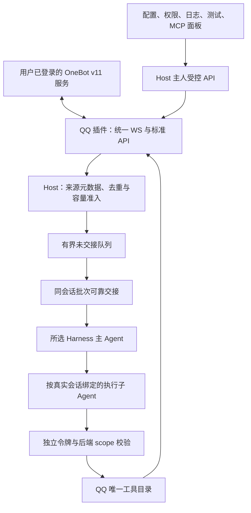

# Eating QQ 与平台能力架构

更新：2026-10-29。QQ0.9.0通过公开SDK2.0.0与API2接入Host，提供正式OneBot v11连接、39项工具、身份及受控代理类型。默认不兼容旧Eating版本，规则见[ADR-0015](../decisions/ADR-0015-默认不兼容旧版.md)；实际流程见[操作说明](../operations/QQ配置与功能测试.md)。

## 职责和数据流

Host不生成AI回复，普通模型文本不转发QQ。QQ核对实际账号与发送者，再把规范化外部信封交Host；Harness自主决定是否委派或沉默。无接收者时仅保有界待投递，不称Agent已读。

## 插件和工具

QQ[后台](../../plugins/communication/qq/src/server.ts)和[面板](../../plugins/communication/qq/src/web/panel.tsx)只依赖公开SDK，不引用应用内部。入口／实际插件／清单种类都为communication，缺失或API不符拒绝，不默认推断。独立产物安装方式见[工程结构](工程结构与插件发布.md)。

[唯一目录](../../plugins/communication/qq/src/backend/operations.ts)同时供Host、MCP与功能测试使用：38公开标准API加1框架quick，共39项，19只读／20副作用／3敏感结果。没有任意action透传，也没有本地聊天历史工具。完整参数、正式别名及19种可发送段见[覆盖清单](../technical/OneBot标准功能覆盖.md)。OneBot标准支持不等于Eating旧API兼容。

文本、数组和单段对象按正式schema校验。字符串默认auto_escape=true，显式false才解释CQ；forward接收后可读取，不冒充发送支持。媒体引用原样交OneBot，Eating不代下载或读取本机文件。

## 当前配置、连接与身份

当前完整QQ配置wrapper只收schema2，缺权限或连接字段拒绝，不从旧配置补齐。真正新实例通过工厂生成完整默认。账号索引维持当前schema1，稳定instanceId与真实accountId分开；目前仅运行一个默认实例，不宣称多账号并行。

统一正向WebSocket同时承载API与事件，Bearer只在头，不接受URL凭据／查询令牌或分离api/event端点。登录资料、online/good成功才显示connected。请求以echo关联，超时／断链／async接纳的副作用为unknown，不自动重发。

主人／管理员配置为安全正整数十进制QQ列表，各最多100；重叠owner优先。接收事件self_id必须匹配实际登录号，sender只按已保存名单核对；正文、昵称或OneBot群角色不授予Eating主人权限，source仍external。结构化媒体／转发引用可作为scope来源，不从普通文本或任意URL授予引用。

连接配置PATCH省字段保当前、空token保原是当前语义；权限通过完整字段＋policyRevision CAS单独保存，不重连。配置读取失败明确错误，不渲染会补默认值的可写空表单，原文件不覆盖。

## 代理类型与执行

QQ声明qq.private／qq.group及各自规则、主委派说明和可选／默认工具。子目录从39工具派生，只包含能绑定当前会话的能力，默认适用只读加本类型明确发送；凭据、无关全局维护、通用send_msg和quick不进入当前子目录。主人手动39功能保持。

工具目录、类型勾选和实际invokeScoped共同检查权限，不能只靠提示词或隐藏名称。每次核对插件／实例／登录账号／类型／目标；消息查询／撤回只用已授权messageId，媒体／转发只用已知resourceId，递归回复／node引用同样检查。发送成功的真实message_id可继续授权本会话查询。

子凭据按任务发行，结束、停用、断开撤销。写请求用agentId＋原request_id命名空间，避免不同代理键冲突；Host真实回执按任务隔离，迟到旧调用不污染新集合。主收到子摘要和实际动作回执后再判断下一步，普通final不自动发送。

## 队列与可靠交接

设置默认persistent、1000条、10MiB、reject-new；静默500ms／最长2000ms／每批10条／目标32KiB，回执超时15秒，明确拒收间隔10秒／最多5次。只按同conversationId聚合，唯一deliverBatch，不提供旧单条分支。

只保存未交接规范化content/text、来源角色与引用，不存原OneBot包或额外正文列。memory退出丢正文，当前模式切换事务转移存活队列，失败保持原设置；这是当前行为，不读取旧库。数据库只接受当前完整结构，旧表／版本写前拒绝。

可靠接管需accepted＋durable＋receiptId和本地确认；不等于模型消费或外部动作成功。明确拒收有限重试，超时／未知／中断保待核对；本地提交失败只重试本地，不重投。drop-oldest只移pending，保护inflight／uncertain，缩容和清空有明确确认并保账本。详细容量口径见[数据规范](../technical/数据目录与账号实例.md)。

## 主人管理、动作与日志

面板五页签：连接配置、代理与权限、实时日志、功能测试、MCP能力。管理API受Session／CSRF／Host／Origin校验；主人手动MCP使用专属Bearer。Harness使用独立scope令牌，不取得主人全权令牌。逻辑范围不等于OS沙箱，已发出的动作不因关闭HTTP被撤回。

动作账本按插件＋账号实例＋登录号＋稳定request_id隔离。同键同参数复用已知结果，改参数拒，running／unknown不重做；同版进程中断running恢复unknown。清空队列或日志不删除账本。

日志仅可见页签订阅，默认100条，50／100／200／500／1000可选，只留浏览器内存；隐藏／离开／停用清空，不落盘、不缓存、不回放。Host SSE最多8查看者、背压断开、15秒注释心跳；无查看者不格式化日志，正常接收和队列准入独立。

## 验证范围

当前983项完整测试和53浏览器、5项实际SDK的证据见[本轮报告](../reports/2026-10-29-删除旧版兼容验证报告.md)。所有自动模型／OneBot为回环，未向真人试发。历史387／653等结果保留在原报告，不是当前旧库迁移承诺。

QQ专有扩展、反向连接、通知／请求自动交接、多账号并行、所有OneBot实现／QQ权限和媒体格式、真实提供商业务、其他Harness与三平台仍需分别验证。
