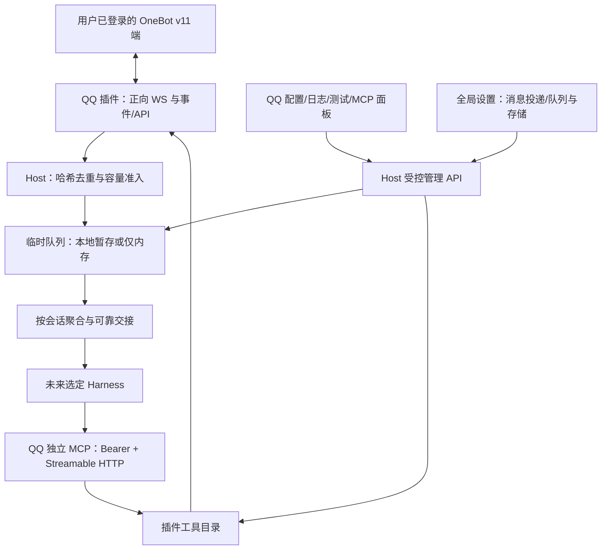

# Eating QQ 与平台能力架构

状态：当前为应用 0.3.0、公开 SDK 1.2.0、QQ 0.4.0，`apiVersion: 1`。本轮移除聊天历史，落地可配置临时队列与会话聚合；最终完整构建/严格类型、Vitest 387/387、浏览器 13/13 通过。真实迁移与安装已完成，未交接信封和账号配置/发送账本标识保持；实际 API 确认 QQ connected、设置读取 200，Harness 仍 not-attached。产品无飞书/微信占位模块，测试协议端只在测试目录。

## 职责与数据流

Host 不生成 AI 回复。QQ 验证平台标识、保持外部来源后，将规范化信封交给 Host；无实际 Harness 接收者时保持有界临时待投递。MCP 是让 Harness 主动调用工具的反向通道，MCP 可用不代表模型已接收输入。Eating 不另建认知循环、聊天库或长期人生记忆。

## 插槽与功能目录

[公开后台 SDK](../../packages/plugin-sdk/src/index.ts)定义插件入口、能力/工具、连接状态、信封、投递设置、批次与回执；[公开界面 SDK](../../packages/ui-sdk/src/index.ts)定义面板与受控请求、日志订阅。QQ 拥有自己的[后台](../../plugins/communication/qq/src/server.ts)、[面板](../../plugins/communication/qq/src/web/panel.tsx)与 [OneBot 配置](../../plugins/communication/qq/src/config.ts)，公共 SDK 不混入专用配置。

QQ 独立构建 `@eating/plugin-qq` 0.4.0，Host 按已安装产物加载，Web 动态导入并共享公开 SDK/React 宿主实例。面板不引用应用私有源码，Host 不静态编入 QQ；安装边界见[工程结构](工程结构与插件发布.md)。

[工具目录](../../plugins/communication/qq/src/backend/operations.ts)是 MCP 与测试面板共同来源，当前 9 项：账号、状态、版本、好友、群、单条消息、私聊发送、群发送、撤回。单条消息调用 OneBot `get_msg`，查询范围由协议端决定。本轮删除 Eating 本地历史工具和页面，不保留历史兼容入口。新功能须在插件目录声明真实 schema、语义和实现，不在 Host 增加 QQ 条件分支。

发送仍为纯文本，显式 `auto_escape=true`。图片/复杂消息段发送、群管理、QQ 空间需后续真实扩展，不提供任意 action 透传绕过工具目录。

## 连接与接收

正向统一 OneBot WebSocket 同时承载 API/事件。Bearer 只在请求头，拒绝 URL 账号密码、查询令牌、分离 `/api`/`/event` 与重定向。实际 `get_login_info` 和 `get_status` 在线/健康核验通过才显示 connected。

请求用 UUID echo 关联乱序返回，限制载荷与未决数，采用超时、有限退避和存活检查；手动断开不自动复活。副作用超时、断链或异步 ACK 视为 unknown，不盲目重发。

接收去重键包括本地实例、实际账号、私聊/群目标、原 message_id，只保留其哈希。消息外部 sender 和正文不能升级为主人权限。转交开关决定是否创建 Harness 信封；不转交时不保存正文或原始事件。准入失败返回明确 rejected，并计数/报告 `lastQueueError`；QQ 在有日志查看者时仍可发布新接收事件与 `queueAdmission`，不把拒收伪装成队列成功。

## 临时队列与设置

全局“设置”提供“消息投递”“队列与存储”，配置存 Host settings 与 revision，不写进 QQ config。默认 persistent、1000 条、10 MiB、reject-new；聚合静默 500 ms、最长 2000 ms、每批 10 条、目标 32 KiB、超时 15 秒、拒收间隔 10 秒、最多 5 次。实际页面中文名称与操作见[使用说明](../operations/QQ配置与功能测试.md)。

只有 outstanding 的规范化 Harness JSON 持正文，不存 OneBot raw 或另列 text。persistent 用 SQLite 暂存并支持重启恢复，memory 只在 RAM、Host 退出后丢失；运行中切换事务迁移现有队列，失败保持原模式与内容。容量统计全部 pending/delivering/uncertain 的 UTF-8 JSON 字节，不能当作整个数据库文件上限。快照在持久模式只聚合 SQL 元数据，避免周期读取大正文。

reject-new 保现有队列，拒收计数与错误可见；drop-oldest 只移最旧 pending，保护 delivering/uncertain；超大单条先拒。缩容无法满足保护条件时整次 409，不部分丢弃；revision 冲突同样 409。清空由用户勾选确认，含在途消息时 409，成功仅删除未交接正文、累计 discarded，保留去重和发送账本。

短期去重只存哈希与回执小元数据，24 小时、常态合计不超过 10000 个；SQLite 连清理也失败时，旧磁盘加内存后备最多 20000 个。旧库迁移保全所有未交接信封，清除终态历史与重复正文，原库一次压缩、不新建聊天备份；旧 backlog 超默认容量仍保留并提示。详见[数据规范](../technical/数据目录与账号实例.md)。

## 聚合与可靠交接

按 `conversationId` 聚合，不跨会话。静默计时随同会话新消息重置，最长等待从首条入队固定；达到条数或目标字节提前，单条大于软目标时独立投递。`deliverBatch` 传递结构化批次，保留旧 `deliver` 时按事件逐条调用，不承诺一次模型请求。

只有 `accepted === true`、`durable === true`、非空 `receiptId` 且本地确认提交成功，才能删除正文并记可靠交接；不表示模型消费。明确拒收才按设置有限重试，超时、异常、缺凭据、中断和重试耗尽转 uncertain 保留待核对，不自动补投。唯一主接收者边界和后续适配责任见[Harness 设计](Harness适配.md)。

## 实例、动作与日志

本版只有一个默认实例，插件 ID、稳定本地实例 UUID、实际账号分别记录。发送账本按插件+实例+实际账号+request_id 隔离；同键同参数复用持久结果，改参数拒绝，进程中断 running 转 unknown。移除历史与清空队列都不删除动作账本。

QQ 四个页签为连接配置、实时日志、功能测试、MCP 能力。日志仅可见页签按需订阅，50/100/200/500/1000 条只存浏览器内存，默认 100；隐藏/离开/关闭/停用后 viewer 归零并清空，不落盘、不缓存、不补发。无查看者不执行日志源 factory 或日志计时器；正常 WebSocket 和队列准入独立运行。

Host 日志 SSE 沿用 ownerSession/Host/Origin 与会话校验，最多 8 个 viewer、背压断开、15 秒注释心跳并清理。仅记录已验证标识、明确群号和最多 500 字纯文本预览；预览替换当前 OneBot 令牌，不承诺通用秘密识别。

## Host、MCP 与验证范围

管理 API 使用本地会话/CSRF、Host/Origin 和请求体校验；MCP 使用插件独立 Bearer，只绑定回环，官方 SDK 提供初始化、工具列表与调用。停用撤销新通道与调用，已发出动作不能靠 HTTP 断开撤销。已批准普通工具调用不逐次审批，功能测试真实发送/撤回额外手动确认。MCP 未自动注册到实际 Harness，逻辑隔离不等于 OS 沙箱。

本轮最终完整构建/严格类型、Vitest 16 文件 387/387、浏览器 13/13 已通过；存储 41 与 Gateway 49 合计 90 项获限定 PASS，设置 API 12、界面 SDK 客户端 5 及设置冲突并发独立只读复核通过。Gateway 新增 16 项真实 SQLite 回归验证本地 ack/状态提交失败只重试本地，不重复 sink；注销双失败无后台计时器，重接/显式通知恢复，关闭有限退出。4 张桌面/390px 设置截图已实际读取检查，pageerror=0、无溢出、历史页签 0、MCP 9；真实迁移、QQ 0.4.0 安装与 connected/设置 200 已核验，见[本轮报告](../reports/2026-10-27-投递设置与无历史队列验证报告.md)。自动测试只用临时数据、协议夹具和独立 sink，没有向真人发测试消息。

正式 QQ 215/5、重组 280/8 与日志 321/10 均为历史阶段结果，原报告不重写。真实 Harness/DSH 插件、反向 WS、多账号并行、QQ 空间、远程暴露、桌面包与跨平台仍未完成。协议依据见[核对记录](../research/QQ协议与MCP核对.md)。
