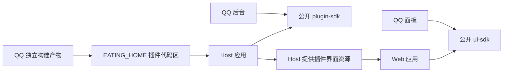

# Eating 工程结构与插件发布

更新：2026-10-28，Asia/Shanghai；当前Host/Web0.6.0、plugin-sdk1.4.0、ui-sdk1.5.0、QQ0.6.0和独立DSH0.2.0已构建部署，面板支持简体中文与English。重组历史始于2026-10-26，对应 [ADR-0012](../decisions/ADR-0012-单仓独立包与插件加载.md)；最小DSH独立安装与整Host恢复见[当前报告](../reports/2026-10-28-DSH最小Harness验证报告.md)。

负责人已确认：**一个仓库，主程序、SDK 与插件独立发包；主程序按构建产物加载插件；插件只依赖公开 SDK。** 以下目录、包名、版本、产物和安装布局是本轮为落实这些原则采用的实现细节，不表示负责人逐项确认了文件名或 manifest 字段。本轮重组已完成构建、测试、独立打包、脱离仓库加载与浏览器验证，实际执行证据见[重组报告](../reports/2026-10-26-单仓独立包重组报告.md)，不沿用重组前结论代替验收。

## 工程归属

```text
Eating/
├── apps/
│   ├── host/                         # Host 应用与安装 CLI
│   │   ├── package.json
│   │   └── src/
│   └── web/                          # 通用管理界面
│       ├── package.json
│       └── src/
├── packages/
│   ├── plugin-sdk/                   # @eating/plugin-sdk，1.4.0
│   │   ├── package.json
│   │   └── src/index.ts
│   ├── ui-sdk/                       # @eating/ui-sdk，1.5.0
│   │   ├── package.json
│   │   └── src/
│   │       ├── index.ts
│   │       ├── contract.ts
│   │       └── api.ts
│   └── plugin-core/                  # 保留纯注册与旧持久化测试
├── plugins/
│   └── communication/
│       └── qq/                       # @eating/plugin-qq，0.6.0
│           ├── package.json
│           └── src/
│               ├── server.ts
│               ├── config.ts         # OneBotConfig 属于 QQ
│               ├── backend/
│               └── web/
│                   ├── entry.tsx
│                   ├── panel.tsx
│                   ├── panel.css
│                   ├── live-logs.tsx
│                   └── live-logs.css
├── docs/
├── scripts/
└── tests/
```

根 pnpm workspace 聚合开发、构建和测试；应用、SDK 与插件各有包边界。仓库统一协作、锁定依赖与回归验证，不要求所有包共享版本或一起发布。

| 位置 | 职责与发布边界 |
| --- | --- |
| [Host](../../apps/host/) | 加载已安装产物、管理插件生命周期、持久化、受控 API、MCP 与安装 CLI；不捆入 QQ 源码或协议实现 |
| [Web](../../apps/web/) | 提供导航、目录、通用状态与面板挂载；按 Host 目录加载插件界面 |
| [后台 SDK](../../packages/plugin-sdk/src/index.ts) | 公开后台注册、能力/工具、状态、消息与 Harness 接收边界；不包含 QQ 专有配置 |
| [界面 SDK](../../packages/ui-sdk/src/index.ts) | 公开面板贡献契约与受控管理 API 客户端，为宿主和插件提供共同入口 |
| [QQ 插件](../../plugins/communication/qq/) | 自管 OneBot 协议、[配置类型](../../plugins/communication/qq/src/config.ts)、工具与专属面板，独立构建为可安装产物 |
| [纯注册核心](../../packages/plugin-core/) | 保留已有纯注册及旧持久化相关测试；不是插件导入宿主私有实现的入口 |

`@eating/plugin-sdk`为`1.4.0`、`@eating/ui-sdk`为`1.5.0`，当前插件契约`apiVersion`为`1`。包的语义版本、契约版本、QQ 包版本是不同信息；不能由“都在同一仓库”推断兼容。

## 依赖方向

QQ 后台和面板通过 `@eating/plugin-sdk`、`@eating/ui-sdk` 等公开入口依赖 Eating。插件可以使用自己的协议及界面依赖，但不能从 Host/Web 源码、宿主私有组件或其他插件中导入实现。QQ 面板不再导入 Web 应用内部文件；通用 SDK 不包含 `OneBotConfig`，该类型由 QQ 插件自行维护。



Host 按安装索引读取后台产物，不扫描仓库内插件源码后直接执行。Web 根据 Host 提供的插件资源执行动态 `import` 并加载样式。公开界面 SDK 通过 `registerUiRuntime` 注册运行时，React 经 Host 的 `/_eating/runtime/react.js` 桥共享宿主实例，避免插件各带一个 React 导致 Hook 或上下文不一致；面板仍只引用公开 SDK。

## 共享多语言界面

UI SDK1.5.0通过公开registerTranslations/useI18n/translate和locale/格式化/错误API支持集中资源。宿主与独立插件分别打包资源，窗口级Symbol服务共享同一个语言选择，无需依赖应用内部路径。插件资源在自己的入口注册，不能将QQ或DSH翻译静态列进宿主，也不能因切语言重挂插件、重新连接或改写用户数据。

默认简体中文，可切English；浏览器只保存eating.locale非敏感偏好，跨页签同步。自然文案、aria、错误、日期和数字本地化；品牌、协议ID、JSON及用户原创内容保持。新增语言扩展资源契约并验证同键与插值。构建/安装/升级边界保持，验证见[本轮报告](../reports/2026-10-28-用户文案与多语言验证报告.md)。

## 按需日志公开边界

按需日志在 SDK 1.1.0、QQ 0.3.0 阶段引入 `PluginLogEntry` 与公开 `subscribePluginLogs(pluginId, handlers)`；当前 SDK 1.2.0、QQ 0.4.0 延续该可选能力，契约 `apiVersion` 仍为 1。Host/Web 0.3.0 新增全局设置与有界无历史队列。工作区返回每个插件的 `logsSupported`，由 Host 泛型 SSE 处理已启用插件的日志，不在通用页面硬编码 QQ 日志协议。

SSE 订阅前经公开客户端完成会话鉴权；Host 核对 ownerSession 与 Host/Origin，最多 8 个查看者，背压断开并由客户端重连。只有打开的查看流每 15 秒注释心跳，关闭时清理；无查看者不执行日志源 factory、无日志定时器、无后台日志缓存或日志文件。这里不增加日志历史、快照或重连补发接口。

插件面板只在实时日志页签打开、页面可见、插件启用且能力可用时订阅；隐藏/离开/pagehide/关闭/停用即清理订阅与内存列表。默认 100 条及 50/100/200/500/1000 选择仅在浏览器组件内存；增加不补历史。metadata 仅已验证的账号/实例/会话/发送者/消息标识、kind 与群聊显式 groupId，正文最多 500 字预览，不记录认证字段，替换正文中的当前 OneBot 令牌，不承诺识别任意消息里的所有秘密，不输出 console。正常 QQ 接收与日志分离；当前消息只按全局队列设置暂存未交接信封，不建设聊天历史。网页手动刷新不是正常收消息的前提。

新增接口需完整构建SDK/Host/Web及相关独立插件，再按停机安装流程更新已校验产物，不能只替换界面文件。当前QQ有9项MCP工具；DSH后台同样由安装索引加载，Host不静态捆入其SDK或实现。两次前置提交为fea2f7a、93a3d51，之后实现DSH；当前QQ0.6.0与DSH0.2.0已安装，生产模型仍为空配置，专属运行时已预装而未启动。部署job与实际数据保持见[项目状态](../项目状态.md)。日志与无历史队列仍按[先前变更](../changes/2026-10-27-投递设置与无历史队列.md)执行。

## 迁移映射

旧路径仅用于说明迁移。现行源码链接统一指向新位置，旧目录不保留 re-export、转发入口或兼容 shim。

| 旧位置 | 新位置 |
| --- | --- |
| `services/host/` | [apps/host](../../apps/host/) |
| `packages/platform-contract/` | [packages/plugin-sdk](../../packages/plugin-sdk/) |
| `plugins/qq/server.ts` | [QQ 后台入口](../../plugins/communication/qq/src/server.ts) |
| `plugins/qq/backend/*` | [QQ 后台目录](../../plugins/communication/qq/src/backend/) |
| `plugins/qq/entry.tsx` | [QQ 界面入口](../../plugins/communication/qq/src/web/entry.tsx) |
| `plugins/qq/panel.tsx` | [QQ 面板](../../plugins/communication/qq/src/web/panel.tsx) |
| `plugins/qq/panel.css` | [QQ 样式](../../plugins/communication/qq/src/web/panel.css) |
| `apps/web/src/plugins/contract.ts` | [公开界面契约](../../packages/ui-sdk/src/contract.ts) |
| `apps/web/src/lib/api.ts` | [公开管理 API 客户端](../../packages/ui-sdk/src/api.ts) |

[Web 应用](../../apps/web/)和[纯注册核心](../../packages/plugin-core/)保留原目录；界面 SDK 新增[公开总入口](../../packages/ui-sdk/src/index.ts)。源码归属调整不迁移账号配置、Host 锁或 SQLite。

## 插件交付产物

QQ 包名为 `@eating/plugin-qq`，当前版本 `0.6.0`；安装后的稳定插件 ID 仍为 `qq`。独立交付目录包含：

```text
<QQ 插件产物>/
├── eating-plugin.json
├── server.mjs
└── ui/
    ├── index.js
    └── style.css
```

清单实际字段包括 `schemaVersion`、`apiVersion`、`id`、`version`、`backend`、`frontend` 与 `integrity`；`integrity` 记录后台及前端各交付文件的 SHA-256，身份、版本与入口直接存于清单对应字段。本页说明清单职责，不重复完整 JSON schema；实际字段以构建产物为准，CLI 顺序见下文。Host 在执行插件入口前检查兼容和文件完整性。

后台及界面需要的交付内容由插件构建负责，不能依赖仓库中的 TypeScript 源码、开发别名或未交付的相邻目录。主程序构建与 QQ 产物构建分开，不能通过在主程序中静态打包 QQ 来替代产物加载验收。

各公开包维护独立包配置中的 `files` 与 `exports`，明确交付内容和导出入口。当前“独立发包”指独立包配置、构建和可安装产物；本轮不向 registry 执行真实 npm 发布，也不承诺任意第三方市场下载或完整第三方依赖解析。

## Harness独立包

[DSH插件](../../plugins/harness/dsh/)位于`plugins/harness/dsh`，包名`@eating/plugin-dsh`、版本0.2.0；同QQ一样只交付清单、server.mjs和ui的JS/CSS。服务端捆入固定官方SDK client，显式dshBin指向Eating专属运行时；庞大DSH/npm依赖树不塞入Host或16MiB插件产物，而在`EATING_HOME/harness/dsh/runtime/versions`显式安装，保留完整lockfile与当前指针。安装只走owner管理API，不成为模型MCP工具。

清单kind区分communication/harness，前者数据在bot、后者在harness；同ID跨kind升级拒绝隐式改绑。界面公共ManagedPlugin提供共同面板，CommunicationPlugin/HarnessPlugin细分类型，通用目录按kind分类，资源失败保持真实类别而不把Harness降成通讯。

实际验证将两独立插件产物复制到临时安装源、校验安装后删除来源，运行时图物理复制到专属目录，通过正式入口完成模型工具回复、沉默和整个Host重启同会话恢复；无需仓库源码相邻导入。普通SDK模型文本不转发QQ。细节见[DSH变更](../changes/2026-10-28-DSH最小Harness接入.md)。

## 安装、升级与卸载

插件代码区使用 `EATING_HOME/plugins`，和账号数据区分开：

```text
~/.eating/
├── plugins/
│   ├── installed.json             # 已安装/激活版本索引
│   └── <pluginId>/
│       └── versions/
│           └── <version>/         # 单个版本的独立产物
├── bot/
│   └── qq-bot/
│       ├── accounts.json
│       └── accounts/<instanceId>/config.json
└── host/                          # 原 Host 锁、SQLite 与 MCP 令牌
```

本轮安装 CLI 从本地构建产物目录安装。安装、升级、卸载均要求 Host 停止，完成后重新启动；这会中断宿主服务，不提供运行中热更新或零中断升级。构建和安装入口已确定：

```bash
pnpm build
pnpm build:plugin
pnpm plugin install plugins/communication/qq/dist
pnpm plugin list
pnpm plugin uninstall qq
```

`pnpm build` 分别构建 SDK、QQ 与 Host/Web；`pnpm build:plugin` 只构建 QQ。首次安装与升级均使用 `plugin install`，校验或索引提交前失败保留旧版本和激活记录；安装后启动 Host 才加载新版本。生产入口为 `node apps/host/dist/main.mjs`，完整操作顺序见[QQ 操作说明](../operations/QQ配置与功能测试.md)。本轮已实际执行构建、安装、升级、卸载与重启回归，范围见下文。

1. 停止使用该数据根的 Host，核对现有锁与目标数据根。
2. 读取本地产物清单，校验插件身份、版本、SDK/API 兼容和文件 SHA-256。
3. 先在暂存区准备完整产物，原子发布版本，再原子切换激活索引；校验或暂存失败保留旧版本，不能激活半个插件。
4. 重启 Host，只加载激活索引选定的产物，再由 Web 读取对应界面资源。

升级只改变目标插件的代码版本及其激活记录，不要求重建其他插件或主程序，不覆盖账号数据。同一版本产物不可变；数据目录冲突及同 ID 改绑校验只针对当前激活记录，不将已卸载插件的历史目录永久占用。索引提交后的目录 fsync 失败明确返回 `unknown` 并保留已激活版本，不能报告已回滚或盲目重装。卸载撤销插件激活与后台、页面、工具/MCP 入口，保留 QQ 账号配置、消息和未决动作；用户数据删除仍需独立明确操作。面板中的停用/恢复与安装 CLI 的代码安装/卸载是不同操作。

SHA-256 证明产物与清单是否一致，不证明发布者可信或建立 OS 沙箱。新增未知可执行能力仍需主人批准；本轮 QQ 已在授权范围内。

## 验证与回退

单仓重组阶段，主流程于 2026-10-27 实测完整构建/严格 TypeScript 通过、Vitest 12 文件 280/280（原 215 + 安装 63 + 产物 2）、Playwright 8/8。安装 63 项覆盖原子发布、摘要/兼容、Host 停机、同版不可变、并发及当前激活数据目录冲突/同 ID 改绑拒绝；浏览器使用安装产物加载后台、JS/CSS，覆盖坏配置、合法 0.2.1+local 和资源 abort 的局部失败/CSS 清理。

两项产物回归将 QQ dist 真正复制到仓库外后安装、调用官方 MCP、升级 0.2.1、删除构建源再重启，最后卸载并逐字核对账号索引/配置保持；空 home 不扫描源码。plugin-sdk、plugin-core、ui-sdk、QQ 四包分别 pack 成功，包内不含 src、node_modules、测试或 workspace: 依赖，未发 registry。

本轮限定独立复核三项 P2 已修复并最终定向 PASS；审查者只读，实际测试由主流程执行。重组时 5180/5181 服务四页签和安装资源已检查，完整证据见[重组报告](../reports/2026-10-26-单仓独立包重组报告.md)。重组前的 215 项单元/集成与 5 项浏览器证据保存在[正式 QQ 报告](../reports/2026-10-26-QQ正式开发报告.md)，首版 65 项结果保留原范围。用户当前已确认真实 QQ 连接成功；本轮自动回归仍不向真人发消息。真实 Harness、多账号并行、完整恶意插件隔离与桌面跨平台仍未完成。

按需实时日志阶段（QQ 0.3.0）完整构建/严格类型检查通过，Vitest 15 文件 321/321、Playwright 10/10；新增源 11、Host SSE 26、界面 SDK 4 项测试和 2 个日志浏览器流程。覆盖保留上限、改容量不回放、配置逐字不变且无新文件，以及隐藏/离页/关闭时 Host 实际 viewer 数归零且正常消息继续入库。QQ 0.3.0 已安装并经实际 API 核验 connected / logsSupported=true，配置和账号索引 SHA 保持。隔离夹具桌面/390px 截图 pageerror 0、无横溢出；关闭后 viewer 归零、账号目录仅 config.json。停用竞态由 mutations 屏障返回 409 阻止，新增 deferred/reject 两项及独立定向复核最终 PASS；证据见[实时日志验证报告](../reports/2026-10-27-QQ实时日志验证报告.md)。

当前设置与无历史队列阶段完整构建/严格类型检查、16 文件387项与13项浏览器通过，3条真实待交接信封规范化指纹保持，QQ0.4.0连接恢复；见[队列设置验证报告](../reports/2026-10-27-投递设置与无历史队列验证报告.md)。schema v2 不被旧Host读取，仍有未交接消息时不能直接覆盖旧Host并假设队列可见；须先安全交接或执行明确的反向迁移，按用户要求移除的历史正文不恢复。

回退前停止 Host 并备份数据根；按经过校验的旧产物恢复目标插件和激活索引。不能只改索引指向缺失或不兼容版本，也不能删除账号目录来恢复代码。按需日志的代码回退基线为已提交的单仓重组 `68031fc`；回退时须配套恢复兼容的 Host/SDK/QQ 产物，不删除正常消息数据。若需审查重组前源码，可只读查看提交 `2532469`；不清理共享工作区或改写历史提交。变更原因与影响见[重组记录](../changes/2026-10-26-单仓独立包重组.md)。
