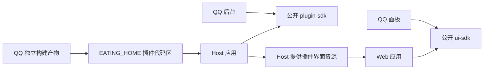

# Eating 工程结构与插件发布

更新：2026-10-29，Asia/Shanghai。当前应用／Host／Web 0.9.1，plugin-core／plugin-sdk／ui-sdk 均为 2.0.0，QQ 0.9.1、DSH 0.4.1；插件只接受 API2。默认不兼容任何旧 Eating 版本，未发布及未来发布均遵循此规则，只有用户明确要求才设计例外，见 [ADR-0015](../decisions/ADR-0015-默认不兼容旧版.md)。完整构建、严格类型及当前格式验证见[本轮报告](../reports/2026-10-29-删除旧版兼容验证报告.md)。本轮没有部署或删除、重置真实数据；当前服务以[项目状态](../项目状态.md)为准。重组历史见 [ADR-0012](../decisions/ADR-0012-单仓独立包与插件加载.md)及本页历史章节。

负责人已确认：**一个仓库，主程序、SDK 与插件独立发包；主程序按构建产物加载插件；插件只依赖公开 SDK。** 以下目录、包名、版本、产物和安装布局是为落实这些原则采用的实现细节，不表示负责人逐项确认了文件名或 manifest 字段。2026-10-26 起的重组阶段已完成构建、测试、独立打包、脱离仓库加载与浏览器验证，实际执行证据见[重组报告](../reports/2026-10-26-单仓独立包重组报告.md)，不沿用重组前结论代替验收。

## 工程归属

```text
Eating/
├── apps/
│   ├── host/                         # Host 应用与安装 CLI
│   │   ├── package.json
│   │   └── src/
│   └── web/                          # 通用管理界面
│       ├── package.json
│       └── src/
├── packages/
│   ├── plugin-sdk/                   # @eating/plugin-sdk，2.0.0
│   │   ├── package.json
│   │   └── src/index.ts
│   ├── ui-sdk/                       # @eating/ui-sdk，2.0.0
│   │   ├── package.json
│   │   └── src/
│   │       ├── index.ts
│   │       ├── contract.ts
│   │       └── api.ts
│   └── plugin-core/                  # @eating/plugin-core，2.0.0
│       └── src/
│           ├── index.ts
│           ├── registry.ts           # 当前纯注册逻辑
│           ├── registry.test.ts
│           └── configuration.ts      # 当前纯配置类型
├── plugins/
│   ├── communication/
│   │   └── qq/                       # @eating/plugin-qq，0.9.1
│   │       ├── package.json
│   │       └── src/
│   │           ├── server.ts
│   │           ├── config.ts         # OneBotConfig 属于 QQ
│   │           ├── backend/
│   │           └── web/
│   └── harness/
│       └── dsh/                      # @eating/plugin-dsh，0.4.1
│           ├── package.json
│           └── src/
│               ├── backend/          # 原生运行时、受控委派、模型与会话读取
│               └── web/              # DSH 配置与手动原生会话看板
├── docs/
├── scripts/
└── tests/
```

根 pnpm workspace 聚合开发、构建和测试；应用、SDK 与插件各有包边界。仓库统一协作、锁定依赖与回归验证，不要求所有包共享版本或一起发布。

| 位置 | 职责与发布边界 |
| --- | --- |
| [Host](../../apps/host/) | 加载已安装产物、管理插件生命周期、持久化、受控 API、MCP 与安装 CLI；不捆入 QQ 源码或协议实现 |
| [Web](../../apps/web/) | 提供导航、目录、通用状态与面板挂载；按 Host 目录加载插件界面 |
| [后台 SDK](../../packages/plugin-sdk/src/index.ts) | 公开后台注册、能力/工具、状态、消息与 Harness 接收边界；不包含 QQ 专有配置 |
| [界面 SDK](../../packages/ui-sdk/src/index.ts) | 公开面板贡献契约与受控管理 API 客户端，为宿主和插件提供共同入口 |
| [QQ 插件](../../plugins/communication/qq/) | 自管 OneBot 协议、[配置类型](../../plugins/communication/qq/src/config.ts)、工具与专属面板，独立构建为可安装产物 |
| [纯注册核心](../../packages/plugin-core/) | 当前纯注册逻辑、测试与[配置类型](../../packages/plugin-core/src/configuration.ts)；旧浏览器持久化公开函数及其路径已删除，没有 re-export 入口 |

`@eating/plugin-core`、`@eating/plugin-sdk`、`@eating/ui-sdk` 均为 `2.0.0`，唯一插件契约为 `apiVersion: 2`。`BackendPlugin`、`BackendPluginEntry` 的 `kind` 必填，并与安装清单一致；不将缺失种类推断为 communication。`HarnessOwnerConfiguration` 的代理类型、插件说明数组及 bindings 必填，Harness 只实现 `deliverBatch`；取得 MCP 必须提交完整 scope，实际动作回执与撤权服务必需，不再保留单条 deliver 或全权令牌回退。包版本、外层协议版本与各数据 schema 分别管理，不能由同仓或相同编号推断旧版兼容。

## 依赖方向

QQ 后台和面板通过 `@eating/plugin-sdk`、`@eating/ui-sdk` 等公开入口依赖 Eating。插件可以使用自己的协议及界面依赖，但不能从 Host/Web 源码、宿主私有组件或其他插件中导入实现。QQ 面板不再导入 Web 应用内部文件；通用 SDK 不包含 `OneBotConfig`，该类型由 QQ 插件自行维护。



Host 按安装索引读取后台产物，不扫描仓库内插件源码后直接执行。Web 根据 Host 提供的插件资源执行动态 `import` 并加载样式。公开界面 SDK 通过 `registerUiRuntime` 注册运行时，React 经 Host 的 `/_eating/runtime/react.js` 桥共享宿主实例，避免插件各带一个 React 导致 Hook 或上下文不一致；面板仍只引用公开 SDK。

## 共享多语言界面

UI SDK 2.0.0 通过公开 registerTranslations／useI18n／translate 和 locale／格式化／错误 API 支持集中资源。宿主与独立插件分别打包资源，窗口级Symbol服务共享同一个语言选择，无需依赖应用内部路径。插件资源在自己的入口注册，不能将QQ或DSH翻译静态列进宿主，也不能因切语言重挂插件、重新连接或改写用户数据。

默认简体中文，可切English；浏览器只保存eating.locale非敏感偏好，跨页签同步。自然文案、aria、错误、日期和数字本地化；品牌、协议ID、JSON及用户原创内容保持。新增语言扩展资源契约并验证同键与插值。代理类型和插件说明可贡献有界 localizedTitles，通用提示词页面按当前语言展示并回退规范 title，不在宿主硬编码 QQ 分支；它只属展示元数据，不写主人覆盖或 system。构建／安装／升级边界保持，多语言历史验证见[原报告](../reports/2026-10-28-用户文案与多语言验证报告.md)。

## 共享工具目录与复杂参数

公开PluginToolDefinition新增可选protocolAction、sensitiveResult；OneBot动作、schema、参数归一化与执行仍在QQ包。面板从Host目录生成表单，共享QQ包内纯校验，不导入Host私有代码或后台实现。@cfworker/json-schema4.1.1不使用动态代码，适配现有CSP；1MiB／64层／50000节点预检与128schema缓存有界。只读凭据不走动作账本，副作用继续账号作用域幂等；工具体限制仅MCP／invoke放大，普通配置仍256KiB。见[本轮变更](../changes/2026-10-28-OneBot完整MCP接入.md)。

## 按需日志公开边界

按需日志在 SDK 1.1.0、QQ 0.3.0 阶段引入 `PluginLogEntry` 与公开 `subscribePluginLogs(pluginId, handlers)`；随后 SDK 1.2.0、QQ 0.4.0 阶段延续，Host／Web 0.3.0 阶段新增全局设置与有界无历史队列。这些是历史引入版本；当前版本见本页开头，只支持 API2。工作区返回每个插件的 `logsSupported`，由 Host 泛型 SSE 处理已启用插件的日志，不在通用页面硬编码 QQ 日志协议。

SSE 订阅前经公开客户端完成会话鉴权；Host 核对 ownerSession 与 Host/Origin，最多 8 个查看者，背压断开并由客户端重连。只有打开的查看流每 15 秒注释心跳，关闭时清理；无查看者不执行日志源 factory、无日志定时器、无后台日志缓存或日志文件。这里不增加日志历史、快照或重连补发接口。

插件面板只在实时日志页签打开、页面可见、插件启用且能力可用时订阅；隐藏/离开/pagehide/关闭/停用即清理订阅与内存列表。默认 100 条及 50/100/200/500/1000 选择仅在浏览器组件内存；增加不补历史。metadata 仅已验证的账号/实例/会话/发送者/消息标识、kind 与群聊显式 groupId，正文最多 500 字预览，不记录认证字段，替换正文中的当前 OneBot 令牌，不承诺识别任意消息里的所有秘密，不输出 console。正常 QQ 接收与日志分离；当前消息只按全局队列设置暂存未交接信封，不建设聊天历史。网页手动刷新不是正常收消息的前提。

新增接口需完整构建 SDK／Host／Web 及相关独立插件，再按停机安装流程更新已校验产物，不能只替换界面文件。QQ 主人手动目录仍为 39 项；主代理只装配原生列类型／委派工具，子代理按类型和任务 scope 开放 QQ 子集。DSH 后台同样由安装索引加载，Host 不静态捆入其 SDK 或实现。前置提交 fea2f7a、93a3d51 属历史实施顺序；本轮已先提交多代理基线 efbd70e，再按用户要求清理旧版兼容并补齐文档，提交与推送结果以 Git 和[项目状态](../项目状态.md)为准。实际部署与模型状态见[项目状态](../项目状态.md)，不沿用旧版空配置或旧 job 作为当前状态。日志与无历史队列仍按[先前变更](../changes/2026-10-27-投递设置与无历史队列.md)执行。

## 目录重组映射（历史）

下表只记录 2026-10-26 起的源码归属调整，不是当前运行时迁移或旧 API 支持。旧路径仅用于说明当时重组。现行源码链接统一指向新位置，旧目录不保留 re-export、转发入口或兼容 shim。

| 旧位置 | 新位置 |
| --- | --- |
| `services/host/` | [apps/host](../../apps/host/) |
| `packages/platform-contract/` | [packages/plugin-sdk](../../packages/plugin-sdk/) |
| `plugins/qq/server.ts` | [QQ 后台入口](../../plugins/communication/qq/src/server.ts) |
| `plugins/qq/backend/*` | [QQ 后台目录](../../plugins/communication/qq/src/backend/) |
| `plugins/qq/entry.tsx` | [QQ 界面入口](../../plugins/communication/qq/src/web/entry.tsx) |
| `plugins/qq/panel.tsx` | [QQ 面板](../../plugins/communication/qq/src/web/panel.tsx) |
| `plugins/qq/panel.css` | [QQ 样式](../../plugins/communication/qq/src/web/panel.css) |
| `apps/web/src/plugins/contract.ts` | [公开界面契约](../../packages/ui-sdk/src/contract.ts) |
| `apps/web/src/lib/api.ts` | [公开管理 API 客户端](../../packages/ui-sdk/src/api.ts) |

[Web 应用](../../apps/web/)和[纯注册核心](../../packages/plugin-core/)保留原目录；界面 SDK 新增[公开总入口](../../packages/ui-sdk/src/index.ts)。源码归属调整不迁移账号配置、Host 锁或 SQLite。

## 插件交付产物

QQ 包名为 `@eating/plugin-qq`，当前版本 `0.9.1`；安装后的稳定插件 ID 仍为 `qq`。独立交付目录包含：

```text
<QQ 插件产物>/
├── eating-plugin.json
├── server.mjs
└── ui/
    ├── index.js
    └── style.css
```

清单实际字段包括 `schemaVersion`、`apiVersion`、`id`、`version`、`kind`、`backend`、`frontend` 与 `integrity`；`integrity` 记录后台及前端各交付文件的 SHA-256，身份、版本与入口直接存于清单对应字段。本页说明清单职责，不重复完整 JSON schema；实际字段以构建产物为准，CLI 顺序见下文。Host 在执行插件入口前检查当前 API2、必填 kind、SDK 版本和文件完整性，旧 API 或缺字段直接拒绝，不补齐旧清单。

后台及界面需要的交付内容由插件构建负责，不能依赖仓库中的 TypeScript 源码、开发别名或未交付的相邻目录。主程序构建与 QQ 产物构建分开，不能通过在主程序中静态打包 QQ 来替代产物加载验收。

各公开包维护独立包配置中的 `files` 与 `exports`，明确交付内容和导出入口。当前“独立发包”指独立包配置、构建和可安装产物；本轮不向 registry 执行真实 npm 发布，也不承诺任意第三方市场下载或完整第三方依赖解析。

## Harness独立包

[DSH插件](../../plugins/harness/dsh/)位于`plugins/harness/dsh`，包名`@eating/plugin-dsh`、版本0.4.1；同QQ一样只交付清单、server.mjs和ui的JS/CSS。服务端捆入固定官方SDK client，显式dshBin指向Eating专属运行时；庞大DSH/npm依赖树不塞入Host或16MiB插件产物，而在`EATING_HOME/harness/dsh/runtime/versions`显式安装，保留完整lockfile与当前指针。安装只走owner管理API，不成为模型MCP工具。

清单与后台入口的必填 kind 区分 communication/harness，前者数据在bot、后者在harness；同ID跨kind升级拒绝隐式改绑。界面公共ManagedPlugin提供共同面板，CommunicationPlugin/HarnessPlugin细分类型，通用目录按kind分类，资源失败保持真实类别而不把Harness降成通讯。

最小 DSH 阶段的模型回复、沉默及整 Host 恢复见[历史变更](../changes/2026-10-28-DSH最小Harness接入.md)。2026-10-28 多代理阶段曾验证 DSH 0.2.0＋QQ 0.7.1 到 DSH 0.3.1＋QQ 0.8.0 的旧产物迁移，当时的 UUID、记录和配置保持证据保留在[历史报告](../reports/2026-10-28-多代理与会话看板验证报告.md)，不构成现版保证。API2 已删除这些旧格式与旧入口的兼容路径。本轮仅验证当前格式的原生多代理、SDK 源码组合及独立产物；保留当前同版重启恢复、ACK 重建和幂等，普通模型文本仍不转发 QQ。

## 安装、升级与卸载

插件代码区使用 `EATING_HOME/plugins`，和账号数据区分开：

```text
~/.eating/
├── plugins/
│   ├── installed.json             # 已安装/激活版本索引
│   └── <pluginId>/
│       └── versions/
│           └── <version>/         # 单个版本的独立产物
├── bot/
│   └── qq-bot/
│       ├── accounts.json
│       └── accounts/<instanceId>/config.json
└── host/                          # 原 Host 锁、SQLite 与 MCP 令牌
```

本轮安装 CLI 从本地构建产物目录安装。安装、升级、卸载均要求 Host 停止，完成后重新启动；这会中断宿主服务，不提供运行中热更新或零中断升级。构建和安装入口已确定：

```bash
pnpm build
pnpm build:plugin
pnpm plugin install plugins/communication/qq/dist
pnpm plugin list
pnpm plugin uninstall qq
```

`pnpm build` 分别构建 SDK、QQ／DSH 及 Host／Web；`pnpm build:plugin` 只构建 QQ。首次安装与升级均使用 `plugin install`，校验或索引提交前失败保留旧版本和激活记录；安装后启动 Host 才加载新版本。生产入口为 `node apps/host/dist/main.mjs`，完整操作顺序见[QQ 操作说明](../operations/QQ配置与功能测试.md)。安装事务的校验、原子发布和卸载保留数据行为见下文；历史跨版迁移证据不表示当前支持旧数据。

1. 停止使用该数据根的 Host，核对现有锁与目标数据根。
2. 读取本地产物清单，校验插件身份、版本、必填 kind、当前 SDK/API2 和文件 SHA-256。
3. 先在暂存区准备完整产物，原子发布版本，再原子切换激活索引；校验或暂存失败保留旧版本，不能激活半个插件。
4. 重启 Host，只加载激活索引选定的产物，再由 Web 读取对应界面资源。

安装新代码版本只改变目标插件代码与激活记录，不覆盖账号数据；它不提供旧 API／旧数据转换，也不保证旧插件可在当前 Host 中运行。当前全部插件与 SDK 须满足 API2。同一版本产物不可变；数据目录冲突及同 ID 改绑校验只针对当前激活记录，不将已卸载插件的历史目录永久占用。索引提交后的目录 fsync 失败明确返回 `unknown` 并保留已激活版本，不能报告已回滚或盲目重装。卸载撤销插件激活与后台、页面、工具/MCP 入口，保留 QQ 账号配置、未交接信封和未决动作；用户数据删除仍需独立明确操作。面板中的停用/恢复与安装 CLI 的代码安装/卸载是不同操作。

SHA-256 证明产物与清单是否一致，不证明发布者可信或建立 OS 沙箱。新增未知可执行能力仍需主人批准；本轮 QQ 已在授权范围内。

## 当前格式与验证

作者只接受 schema2、6 种作用域和 9 个受信变量，scope／source 必填，无旧群私模板、legacy 集合或外部消息变量。Host SQLite 必须为完整当前表形状与 `user_version=1`；QQ 配置使用 schema2 wrapper 和完整 11 字段，只有文件不存在才创建完整新实例默认值。账号索引、安装索引与 DSH 配置／会话保持各自当前严格 schema1；DSH agent-bindings 使用 schema2，任务 ID 与 refs 必填。旧格式报错且原数据不被自动转换、覆盖或删除；坏配置在相应页面显示错误，不渲染可写空表单或补权限默认值。

仓库没有旧版数据迁移脚本。没有用户明确处置指令，不重置真实 `~/.eating`；用新的 `EATING_HOME` 初始化的是新实例与新会话，不能描述为迁移。当前 PATCH、省略连接字段保留、空 Key 保留、正常重连、同版恢复、插件默认更新保留主人覆盖与新实例完整默认配置继续有效；OneBot v11 正式协议别名和 OpenAI 接口也继续支持。

本轮完整构建／严格类型通过，41 文件 983/983（37.03 秒），其中 5 项实际 SDK 验证为多代理 3 项、源码／独立产物 2 项；浏览器 53/53（18.5 秒）。全部使用临时目录和回环模型／OneBot，不代测付费 API、不向真人发送，也没有部署到真实数据根。完整实跑需显式提供独立运行时：

```bash
pnpm build
pnpm typecheck
EATING_DSH_TEST_RUNTIME="$PWD/.impeccable/runtime-cache/dsh" pnpm exec vitest run --maxWorkers=4
pnpm test:e2e
```

未设置运行时会跳过 5 项，不能算完整实跑；不再要求旧公开插件目录或执行旧版迁移案例。SDK 构建先清目标 dist，已验证旧浏览器存储公开导出为空、旧 persistence 声明不存在，不能靠遗留构建产物恢复旧入口。完整证据见[当前报告](../reports/2026-10-29-删除旧版兼容验证报告.md)与[README](../../README.md)。

## 阶段验证与回退记录（历史）

以下版本、数字和安装结果记录当时事实，不作为 API2 的旧版本支持承诺。

单仓重组阶段，主流程于 2026-10-27 实测完整构建/严格 TypeScript 通过、Vitest 12 文件 280/280（原 215 + 安装 63 + 产物 2）、Playwright 8/8。安装 63 项覆盖原子发布、摘要/兼容、Host 停机、同版不可变、并发及当前激活数据目录冲突/同 ID 改绑拒绝；浏览器使用安装产物加载后台、JS/CSS，覆盖坏配置、合法 0.2.1+local 和资源 abort 的局部失败/CSS 清理。

两项产物回归将 QQ dist 真正复制到仓库外后安装、调用官方 MCP、升级 0.2.1、删除构建源再重启，最后卸载并逐字核对账号索引/配置保持；空 home 不扫描源码。plugin-sdk、plugin-core、ui-sdk、QQ 四包分别 pack 成功，包内不含 src、node_modules、测试或 workspace: 依赖，未发 registry。

本轮限定独立复核三项 P2 已修复并最终定向 PASS；审查者只读，实际测试由主流程执行。重组时 5180/5181 服务四页签和安装资源已检查，完整证据见[重组报告](../reports/2026-10-26-单仓独立包重组报告.md)。重组前的 215 项单元/集成与 5 项浏览器证据保存在[正式 QQ 报告](../reports/2026-10-26-QQ正式开发报告.md)，首版 65 项结果保留原范围。用户当前已确认真实 QQ 连接成功；本轮自动回归仍不向真人发消息。上述重组阶段尚未接真实 Harness；当前 DSH 的本地原生证据见本轮报告，多账号并行、完整恶意插件隔离与桌面跨平台仍未完成。

按需实时日志阶段（QQ 0.3.0）完整构建/严格类型检查通过，Vitest 15 文件 321/321、Playwright 10/10；新增源 11、Host SSE 26、界面 SDK 4 项测试和 2 个日志浏览器流程。覆盖保留上限、改容量不回放、配置逐字不变且无新文件，以及隐藏/离页/关闭时 Host 实际 viewer 数归零且正常消息继续入库。QQ 0.3.0 已安装并经实际 API 核验 connected / logsSupported=true，配置和账号索引 SHA 保持。隔离夹具桌面/390px 截图 pageerror 0、无横溢出；关闭后 viewer 归零、账号目录仅 config.json。停用竞态由 mutations 屏障返回 409 阻止，新增 deferred/reject 两项及独立定向复核最终 PASS；证据见[实时日志验证报告](../reports/2026-10-27-QQ实时日志验证报告.md)。

设置与无历史队列历史阶段完整构建/严格类型检查、16 文件387项与13项浏览器通过，3条真实待交接信封规范化指纹保持，QQ0.4.0连接恢复；见[队列设置验证报告](../reports/2026-10-27-投递设置与无历史队列验证报告.md)。当时 schema v2 不被旧 Host 读取，因此不能覆盖旧 Host 后假设队列可见。该阶段的迁移与回退安排属于历史；现版按 ADR-0015 拒绝旧格式，不提供自动反向迁移或恢复已移除正文。

重组及日志阶段曾采用下列回退安排：停止 Host 并备份数据根，按当时校验的旧产物恢复目标插件和激活索引。不能只改索引指向缺失或不兼容版本，也不能删除账号目录来恢复代码。按需日志的代码回退基线为已提交的单仓重组 `68031fc`；回退时须配套恢复兼容的 Host/SDK/QQ 产物，不删除正常消息数据。若需审查重组前源码，可只读查看提交 `2532469`；不清理共享工作区或改写历史提交。变更原因与影响见[重组记录](../changes/2026-10-26-单仓独立包重组.md)。

当前不承诺跨 Eating 版本的代码／数据回退兼容。只有用户明确要求时才另行设计目标版本、数据快照与转换／回退方案，设计本身不授权执行或删除真实数据。
