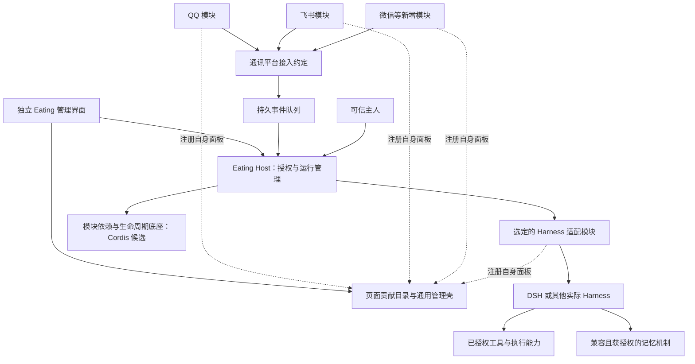

# Eating 总体架构

结论：Eating 提供可扩展宿主，用户选择具体 Harness；通讯平台、Harness 及管理面板通过模块注册。唯一 AI 身份不变，Host 不承担认知决策。

状态：原则已确认，首版前端业务注册/自有面板已实现并验证，具体后台接口/进程/技术栈仍 Proposed。实际范围见[首版说明](../research/首版平台验证说明.md)，未将前端通过扩大到完整系统。

这是职责与依赖图，不代表运行时已兼容、所有模块同进程或所有基础服务必须插件化。

| 模块 | 负责 | 边界 |
| --- | --- | --- |
| Shell/通用 UI | 展示动态目录、配置/授权入口与窗口生命周期 | 不硬编码各平台，不直连运行时高权限内部资源 |
| Eating Host | 可信授权、能力/进程/事件/资源/恢复与状态 | 不生成 AI 意图或重写 Harness |
| 业务注册表/契约 | 平台、Harness、页面的身份/版本/能力/归属与撤销 | 无具体 SDK/平台条件分支依赖 |
| 平台模块 | 连接、账号实例、收发、历史/状态和自有管理页 | 不依赖同类实现；离线补收依实际平台能力 |
| Harness 适配器 | 具体 SDK/配置/会话/事件/能力差异和自有诊断页 | 通用模块不读取其内部类型；不伪造缺失能力 |
| 选定 Harness | 唯一主认知控制、行动选择、上下文/记忆使用、受支持的子 Agent/调度 | 可用特性逐项验证；不保证所有运行时等价 |
| 后台插件底座 | 依赖、作用域、启停、清理 | Cordis 仅候选，不承担全部前端/安全/进程隔离 |
| 运行存储 | 队列、映射、审批、操作账本、诊断 | 不变成第二份人生记忆库 |

## 依赖与隔离

通用管理页读注册目录；QQ、飞书依赖通讯约定，互不直接引用。模块后台与前端入口各自装配，通过稳定身份关联。撤销模块不删除共享服务或其他模块配置，不让迟到响应复活页面/工具。

功能、数据、故障、权限四类隔离分开设计。Cordis scope/工具过滤不是 OS 沙箱；同进程崩溃或阻塞仍会互相影响，应按风险使用独立进程和受控执行。

## 认知与故障边界

Host 的投递、唤醒、预算、恢复是基础设施；活动和休息由所选 Harness 中主 Agent 决定。同一 AI 数据集初期只允许一个活跃主认知控制者，不因安装多个适配器而形成多个个体。

运行时故障不丢已持久化事件，关窗口不等于全退出。更换 Harness 不自动迁移原生会话/记忆；热切换未承诺，必须核对在途动作和目标能力。

## 设计入口

[插槽式扩展](插槽式扩展.md)、[Harness 适配](Harness适配.md)、[DSH 专属集成](DSH集成.md)、[主会话](主会话模型.md)、[消息](消息与投递.md)、[自主性](自主活动.md)、[插件](插件与能力.md)、[数据](数据归属.md)、[Cordis 评估](../technical/Cordis选型评估.md)、[ADR](../decisions/项目说明.md)。
