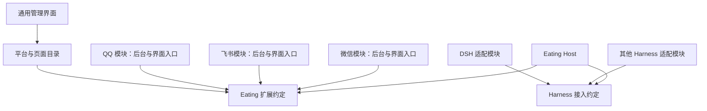

# Eating 插槽式扩展设计

结论：**Eating 提供稳定的扩展约定和通用管理入口，通讯平台、Harness 及其管理面板通过独立模块注册。新增或移除一个实现，主要改变该模块，不要求改写其他实现或通用管理系统。**

状态：架构原则已由负责人于 2026-10-26 确认，对应 [ADR-0007](../decisions/ADR-0007-插槽式模块与界面注册.md)。下文保留通用设计职责，具体交付已由[工程结构与插件发布](工程结构与插件发布.md)及 [ADR-0012](../decisions/ADR-0012-单仓独立包与插件加载.md)细化；正式 QQ 已有实现，本轮安装/产物加载已于 2026-10-27 完成回归，见[重组报告](../reports/2026-10-26-单仓独立包重组报告.md)。候选 Harness 接口、完整隔离与未覆盖生命周期不能据此标成已实现。

## 现状与问题

原文档虽支持插件和多平台，但没有明确通用管理页如何动态发现平台、后台与页面如何共同撤销，也将宿主直接绑定 DSH。若通用页面枚举 QQ/飞书/微信并直接调用各自服务，增加一个平台就要修改多个核心文件，无法满足独立增删的目标。

## 模块与插槽

| 插槽/职责 | 模块提供 | 宿主提供 |
| --- | --- | --- |
| 通讯平台 | 连接/账号管理、收发、可用能力、状态与管理页贡献 | 通用平台注册表、账号实例目录、事件入口和统一管理壳 |
| Harness | 启停/配置/会话/事件适配、能力声明、运行时管理页贡献 | 运行时注册表、选择入口、主身份映射、权限与资源管理 |
| 管理界面 | 菜单/路由/配置或状态页面入口、所需权限和后台关联 | 页面注册与挂载、通用导航、权限校验、撤销和错误承载 |

QQ 和飞书分别依赖 Eating 的通讯契约，不互相引用。机器人管理页读取已注册平台及账号实例，不通过硬编码分支枚举具体平台。一个平台模块可以产生多个账号实例；平台定义、账号连接和页面实例不要混成同一个标识。

模块包可以同时包含后台入口和前端入口，**后台实现不直接依赖 React 页面或浏览器对象**。两个入口使用同一模块身份与版本，通过宿主注册机制关联。通用页面不导入所有平台的私有组件和协议。

## 面板自注册的含义

模块向宿主声明名称、图标、稳定 ID、版本/契约范围、能力、后台入口、前端入口及权限等元数据；这些是候选职责，不是冻结的 manifest schema。

宿主根据声明发现、验证并注册模块；模块的前端入口在界面运行环境中注册自己的面板。普通配置可研究按 schema 渲染，扫码/复杂登录等专属界面由模块提供。前后端的资源加载、版本协商、通信和授权仍需要 Eating 自己实现。

用户通过面板安装或注册**已经实现对应协议的模块**后，可以把微信等加入目录。只填写一个名称不产生平台接入代码。模块发现不能先运行任意代码再补审批，安装新可执行能力仍需主人明确批准。

## 注册与撤销

候选生命周期：发现并验证声明 → 核对授权与依赖 → 启动相关后台 → 发布平台/运行时能力 → 在 UI 注册入口。安装、激活、连接成功是不同状态，界面就绪不等于平台在线。

停用/卸载时，先阻止本模块新操作，处理或标记在途结果，再停止所属连接与后台，撤销它的工具/服务/页面注册，清理订阅、定时器和组件状态。前后端不能一边已移除、一边仍能发起有效高权限请求；迟到响应不得重新恢复已撤销的入口。

注册失败需要撤销本次已创建的注册并报告失败；不能留下半可用菜单。页面被撤销时，选中项回退到通用管理入口；全部通讯模块移除后，系统仍能展示可用的空状态和管理能力。

停用、卸载程序和删除账号/历史数据是不同操作。仅卸载模块不默认删除其他模块数据；本模块凭据、历史和待确认动作的保留/删除策略也需明确。共享依赖按真实依赖关系处理，不能因飞书卸载删除 QQ 仍需的依赖。

## 四类隔离

- 功能与依赖隔离：模块只依赖契约和声明的共享服务；独立增删不要求改其他平台。
- 状态与数据隔离：模块/账号/贡献项具有明确归属和命名空间；不能互相覆盖配置或撤销注册。
- 故障隔离：同进程阻塞、崩溃和内存耗尽仍可互相影响，按风险采用独立进程、超时和有限恢复。
- 权限隔离：Cordis scope、注册表和工具清单均不代替 OS 权限、受控安装和凭据隔离。

移除共享服务影响其真实依赖者是合理的依赖行为；应提前提示并限制影响范围。删除一个普通平台模块不应反向卸载共享基础服务或拖停无关模块。

本轮代码安装、升级与卸载要求 Host 停止后重启，不提供运行时热安装、热卸载或零中断升级。整体重启会中断服务，不能据此宣称已通过故障隔离或无中断验收。

## 验证标准

用两个模拟通讯模块和一个模拟 Harness，验证独立注册、自有页面出现、QQ 持续可用时移除飞书、重新安装无重复注册、迟到响应、重复 ID/版本不兼容、单模块失败和全部模块移除。涉及真实进程隔离另做崩溃/阻塞测试，不以模块逻辑测试代替。

首版阶段曾实现并验证**前端业务子集**：纯注册表、目录驱动分类、QQ/飞书/微信自有组件、配置保存/移除保留与浏览器恢复；详见[首版说明](../research/首版平台验证说明.md)。这不是 Cordis/后台动态加载、账号连接、进程/OS 隔离或完整 Phase 0B 通过。其余计划见 [Phase 0B](../plans/路线图与PoC计划.md)、[Harness 适配](Harness适配.md)、[Cordis 评估](../technical/Cordis选型评估.md)与[权限](../security/权限与授权.md)。
